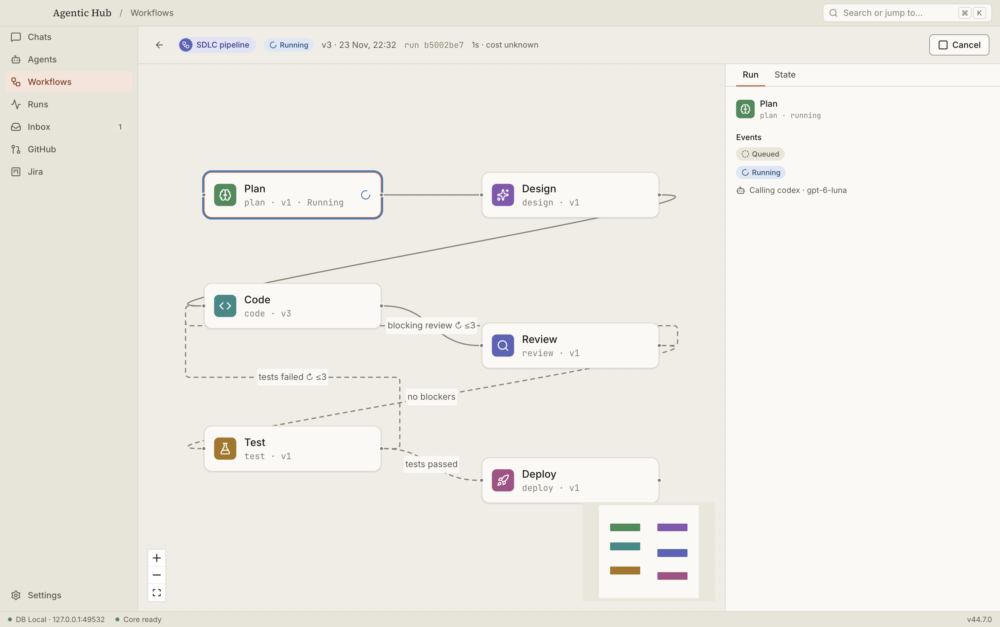

# Agentic Hub

A macOS-first desktop app for building AI agents, composing them into
workflows, and chatting with an **App**, **Agent**, or **Workflow** target.
Every run's state lives on a **local LangGraph server embedded in the app**.
GitHub and Jira integrations. LLMs via the **Claude Code, Codex, Gemini,
and OpenCode CLIs** plus the **OpenRouter API**. An `agentic` CLI.

**Stack:** TypeScript · Electron · React · LangGraph.js · PostgreSQL (local
service or remote team DB) · Hono · Drizzle · Tailwind + shadcn/ui

## Status

Every roadmap phase (0–18) is built: features, logging, tests, security
review, docs, basic user auth, and macOS packaging. The release pipeline
builds dmg and zip files for Apple silicon and Intel; signing and
notarization wait on the owner's Apple Developer ID (see
[`docs/release.md`](docs/release.md)). To run from source:

```bash
pnpm install
pnpm dev
```

To build the app: `pnpm --filter @agentic/desktop package --mac --arm64 --publish never`.

See [`CONTRIBUTING.md`](./CONTRIBUTING.md) for requirements and commands.

## Run the examples

Install **SDLC pipeline** and **Marketing Campaign Draft** from **Workflows → Templates**.
Their nine agents use GPT-6 Luna through your signed-in Codex CLI. Marketing
only needs the model. SDLC also needs access to a GitHub repository where
you can open and merge a test pull request. [Example inputs and instructions](docs/user-guide/workflows.md#try-the-examples).

OpenRouter, GitHub and Jira use your own credentials when you enable them.
Enter keys in the desktop app’s Settings. It stores them in the local
encrypted vault. Headless Core accepts credentials through the environment.
[Provider setup](docs/user-guide/getting-started.md#connect-a-model-provider) ·
[Headless configuration](docs/user-guide/cli.md).

## Screenshots

Captured in full-screen mode on macOS with sample data.



| View | Screenshots |
| --- | --- |
| Chat | [Jira task sent to the SDLC workflow](docs/screenshots/chat.png) |
| Agents | [Installed agents](docs/screenshots/agents.png) · [Inputs and outputs](docs/screenshots/agent-input-output.png) · [Playground result](docs/screenshots/agent-run.png) · [Runtime and more actions](docs/screenshots/agent-more.png) |
| SDLC pipeline | [Canvas and review agent](docs/screenshots/sdlc-canvas.png) · [Run setup](docs/screenshots/sdlc-launch.png) · [Live run](docs/screenshots/sdlc-running.png) · [Completed run and test output](docs/screenshots/sdlc-result.png) |
| Marketing Campaign Draft | [Workflow canvas](docs/screenshots/marketing-canvas.png) |

## Docs

| Doc | What's in it |
| --- | --- |
| [User guide](./docs/user-guide/README.md) | Agents, workflows, chat targets, runs, integrations, team DB, the CLI |
| [`CONTRIBUTING.md`](./CONTRIBUTING.md) | Setup, conventions, tests, adding a provider, tool, or integration |
| [`ROADMAP.md`](./ROADMAP.md) | Goals, key decisions, and the step-by-step plan with todo/done status |
| [`docs/architecture.md`](./docs/architecture.md) | Process model, package layers, data model, runtime flows, scalability |
| [`docs/adr/`](./docs/adr/README.md) | Architecture decision records |
| [`SECURITY.md`](SECURITY.md) | How to report a vulnerability privately |
| [`docs/security.md`](./docs/security.md) | Threat model, review results, dependency policy |
| [`docs/design-system.md`](./docs/design-system.md) | Claude-light theme, identity colors, UX principles, component catalog |
| [`docs/reference-review.md`](./docs/reference-review.md) | Review of the reference app: what we keep, fix, and port |
| [`AGENTS.md`](./AGENTS.md) | Rules for coding agents working in this repo |

## License

Agentic Hub is available under the [MIT License](LICENSE).
